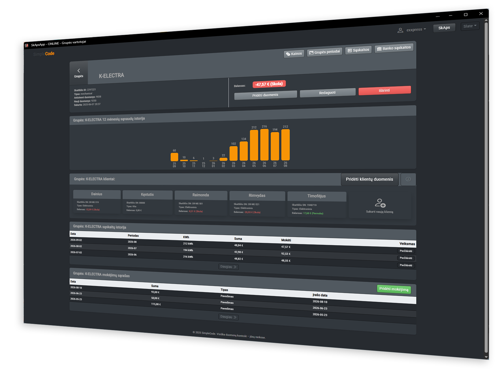

# SkAps - Skaitiklių Apskaitos Programa (django)

# SkAps - Skaitiklių Apskaitos Programa (PyQT)

## Aprašymas

Programa yra subalansuota mažų bendrijų elektros ar vandens skaitiklių apskaitai.

**SkAps (PyQT)** yra skaitiklių apskaitos programa, sukurta naudojant Python, PyQt ir SQLite duomenų bazę. Ji apima įvairias
funkcijas, skirtas valdyti grupes, periodus, klientus, jų duomenis, mokėjimus ir sąskaitas. 

**SkAps (django)** sukurta naudojant Python, Django ir PostgrsSQL duomenų bazę.

## Funkcijos

- **Grupių valdymas**: Kurkite, redaguokite ir peržiūrėkite grupes.
- **Periodų valdymas**: Valdykite apskaitos periodus.
- **Klientų valdymas**: Kurkite naujus klientus.
- **Duomenų valdymas**: Peržiūrėkite klientų informaciją, Tvarkykite, redaguokite jų duomenis.

**Mokėjimų valdymas**: Sekite ir valdykite mokėjimus.
- **Sąskaitų valdymas**: Generuokite ir tvarkykite sąskaitas.
